# Bielsa Garden — Manual de usuario

| | |
|---|---|
| **Juego** | Bielsa Garden |
| **Materia** | _(a completar)_ |
| **Integrantes** | _(a completar)_ |
| **Fecha** | 5 de noviembre de 2026 |
| **Versión** | 1.0 |

---

## Índice

1. [Introducción](#1-introducción)
2. [Requisitos e instalación](#2-requisitos-e-instalación)
3. [Controles](#3-controles)
4. [Recorrido por las pantallas](#4-recorrido-por-las-pantallas)
5. [Cómo se juega](#5-cómo-se-juega)
6. [Personajes (plantas)](#6-personajes-plantas)
7. [Zombies](#7-zombies)
8. [Niveles y tutorial](#8-niveles-y-tutorial)
9. [Preguntas frecuentes y problemas comunes](#9-preguntas-frecuentes-y-problemas-comunes)

---

## 1. Introducción

*Bielsa Garden* es un juego de defensa de torres para computadora, inspirado en la mecánica de *Plants vs. Zombies*. Los zombies avanzan por un jardín de 5 filas y 9 columnas, de derecha a izquierda, hacia la casa del jugador. El jugador los frena colocando personajes en el césped. Cada personaje cumple una función: generar energía, disparar, resistir mordidas, explotar, etcétera.

El juego tiene un tutorial y tres niveles, que se desbloquean de a uno. Marcelo Bielsa acompaña al jugador como guía: explica el tutorial y comenta el comienzo y el final de cada nivel.

## 2. Requisitos e instalación

### 2.1 Requisitos

| Elemento | Requisito |
|---|---|
| Sistema operativo | Windows, Linux o macOS con Python instalado. El juego se desarrolló y se probó en Windows 10. |
| Python | Versión 3.8 o superior. Se probó con Python 3.8.10. |
| Biblioteca gráfica | `pygame-ce` (se probó con la versión 2.5.2). |
| Pantalla | Resolución mínima de 1000 × 600 píxeles. |
| Entrada | Mouse y teclado. |
| Sonido | Opcional. Sin placa de sonido el juego funciona igual, sin música ni efectos. |

### 2.2 Instalación

1. Instalar Python desde <https://www.python.org/downloads/>. En Windows, marcar la opción **"Add Python to PATH"** durante la instalación.
2. Abrir una terminal (en Windows, *Símbolo del sistema* o *PowerShell*) e instalar la biblioteca gráfica:

   ```bash
   pip install pygame-ce
   ```

3. Copiar la carpeta del juego a la computadora. Debe conservar su estructura: `main.py`, `assets/`, `scenes/`, etcétera.

### 2.3 Ejecución

Desde la carpeta del juego (la que contiene `main.py`):

```bash
python main.py
```

Primero aparece una pantalla de carga y, después, la presentación animada del menú principal.

## 3. Controles

El juego se maneja principalmente con el mouse. Las teclas son atajos.

### 3.1 En la partida

| Acción | Mouse | Teclado |
|---|---|---|
| Elegir un personaje | Clic en su carta, en la barra superior | Teclas `1` a `9` (por la posición de la carta) |
| Colocar el personaje elegido | Clic en una casilla libre del césped | — |
| Cancelar la elección | Clic derecho | Volver a apretar la misma tecla |
| Elegir la pala | Clic en el botón **PALA** | `S` |
| Quitar un personaje con la pala | Con la pala elegida, clic sobre el personaje | — |
| Juntar energía | Clic sobre un dedo brillante | — |
| Cambiar la velocidad (x1 → x2 → x3 → x1) | Clic en el botón de velocidad (arriba a la derecha) | `F` |
| Pausar o reanudar | Botón **CONTINUAR** del menú de pausa | `P` o `Esc` |

### 3.2 En los diálogos de Bielsa

| Acción | Control |
|---|---|
| Completar el texto que se está escribiendo / pasar al siguiente | Clic o cualquier tecla |
| Saltear todo el diálogo | `Esc` |

### 3.3 En los menús

| Pantalla | Controles |
|---|---|
| Presentación del menú | Clic, `Enter`, `Espacio` o `Esc` la saltean. |
| Menú principal | Clic en un botón, o flechas ↑/↓ (o `W`/`S`) y `Enter`/`Espacio`. |
| Mapa de niveles | Clic en un nivel disponible. `Esc` vuelve al menú. |
| Elegí tu equipo | Clic en una carta para sumarla o quitarla. `Enter`/`Espacio` empiezan el nivel. `Esc` vuelve al mapa. |
| Catálogo | Clic en las pestañas y en **VOLVER**. Pasar el mouse sobre un personaje muestra su ficha. `Esc` vuelve. |
| Opciones | Clic en los controles, en **APLICAR** y en **VOLVER**. `Esc` vuelve sin guardar. |
| Resultado | Clic en un botón. `Esc` vuelve al mapa. |

## 4. Recorrido por las pantallas

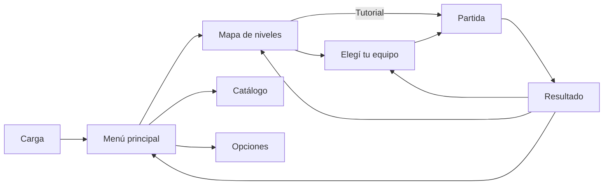

### 4.1 Pantalla de carga y menú principal

Al abrir el juego aparece la pantalla de carga ("PRESENTANDO..."). Después llega la presentación animada, sincronizada con la música, que se puede saltear con un clic. Al terminar quedan los cuatro botones del menú: **JUGAR**, **CATÁLOGO**, **OPCIONES** y **SALIR**.

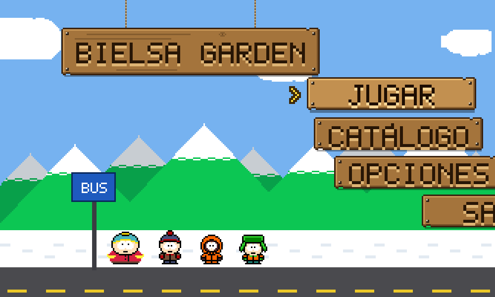

La presentación se ve una sola vez por ejecución. Si después se vuelve al menú, aparece directamente con los botones.

### 4.2 Opciones

Permite elegir la **resolución** de la ventana (entre las que entran en el monitor: 1000 × 600, 1280 × 720, 1366 × 768, 1600 × 900, 1920 × 1080 y 2560 × 1440) y activar la **pantalla completa**. Los cambios se aplican con **APLICAR** y se guardan en `config.json`, así que se conservan para la próxima vez. **VOLVER** o `Esc` descartan los cambios no aplicados.

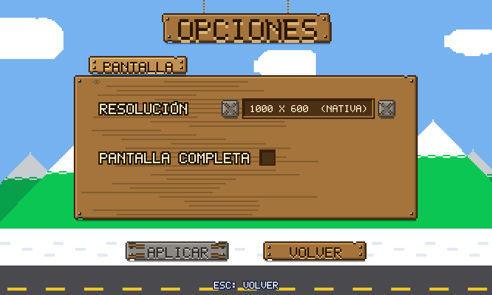

### 4.3 Mapa de niveles

Muestra el camino que une el Tutorial (T) y los niveles 1, 2 y 3. Cada botón tiene uno de tres estados:

- **Bloqueado** (gris, con candado): todavía no se puede jugar.
- **Disponible** (marrón, con una flecha amarilla que salta encima): es el próximo nivel por jugar.
- **Ganado** (dorado): ya se superó y se puede volver a jugar.

Al pasar el mouse sobre un botón aparece el nombre del nivel.

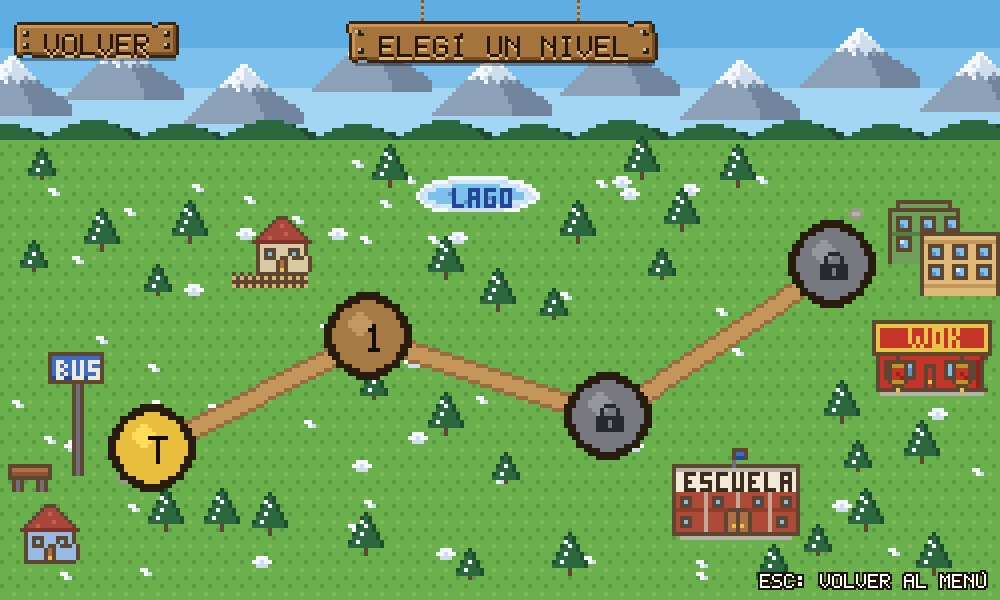

### 4.4 Catálogo

Tiene dos pestañas: **PERSONAJES** y **ZOMBIES**. Al pasar el mouse sobre una ficha aparece su descripción y sus números: costo, daño, vida y recarga en el caso de los personajes; vida total, daño por segundo y velocidad en el de los zombies.

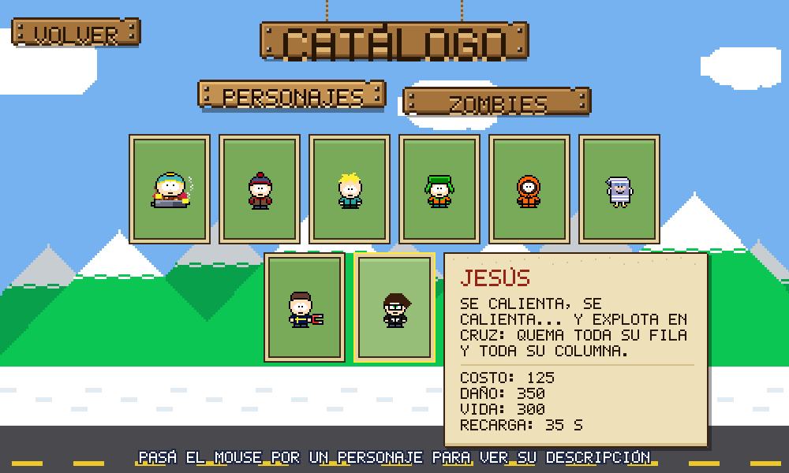

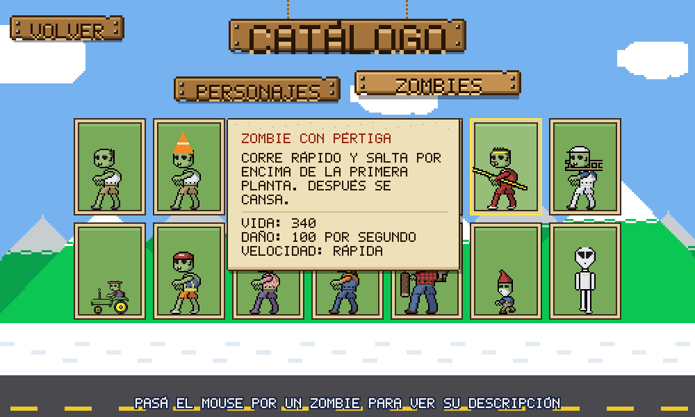

### 4.5 Elegí tu equipo

Antes de cada nivel, salvo el tutorial, se eligen **hasta 7 personajes** entre los disponibles. A la izquierda están todos los personajes; arriba, los lugares del equipo; a la derecha, en el tablón **VIENEN**, los zombies que aparecen en ese nivel. Hay que elegir al menos uno para empezar. El último equipo elegido se recuerda mientras el juego esté abierto.

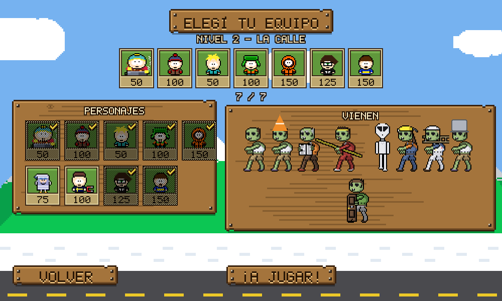

### 4.6 Partida

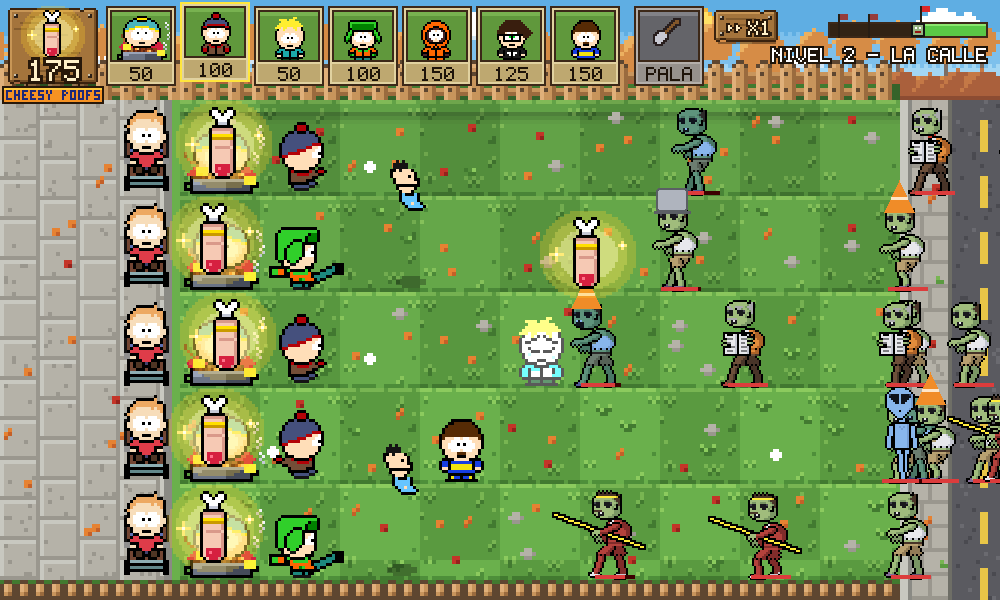

- **Arriba a la izquierda**: el contador de energía (**CHEESY POOFS**).
- **Barra superior**: las cartas del equipo, con su costo. Una carta oscurecida no se puede usar, porque falta energía o porque está en recarga.
- **PALA** y botón de **velocidad** (X1, X2 o X3).
- **Abajo a la derecha**: el nombre del nivel y la barra de progreso de las oleadas, con una bandera por cada horda.
- **A la izquierda del césped**: las podadoras (Timmy en su silla de ruedas), una por fila.

Cuando se acerca una horda, cae un cartel que avisa **"¡SE VIENE UNA HORDA!"**, y antes de la última, **"¡OLEADA FINAL!"**.

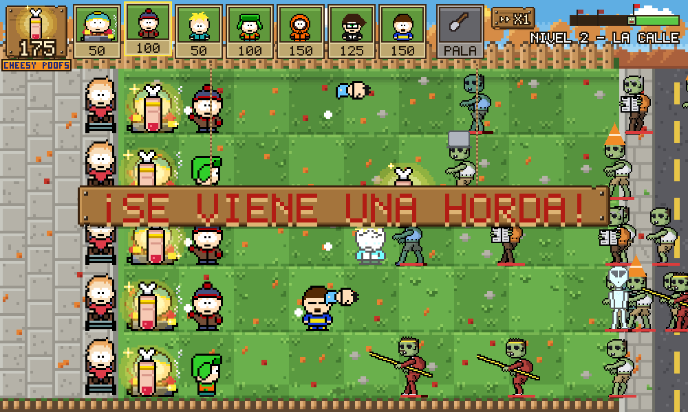

### 4.7 Pausa

Con `P` o `Esc` la partida se congela y aparece el menú de pausa: **CONTINUAR**, **VOLVER AL MAPA** y **MENÚ PRINCIPAL**. Si se sale al mapa o al menú, el progreso del nivel en curso se pierde.

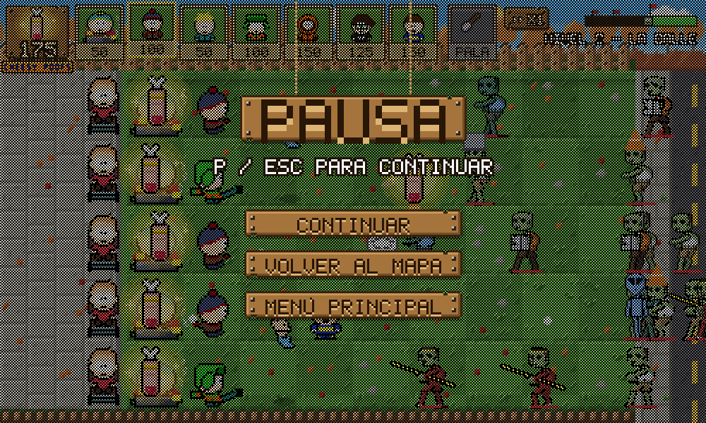

### 4.8 Diálogos de Bielsa

Bielsa aparece al comienzo de cada nivel, en cada paso del tutorial y al terminar un nivel. Mientras habla, la partida queda detenida. El texto aparece letra por letra y avanza con un clic o con cualquier tecla.

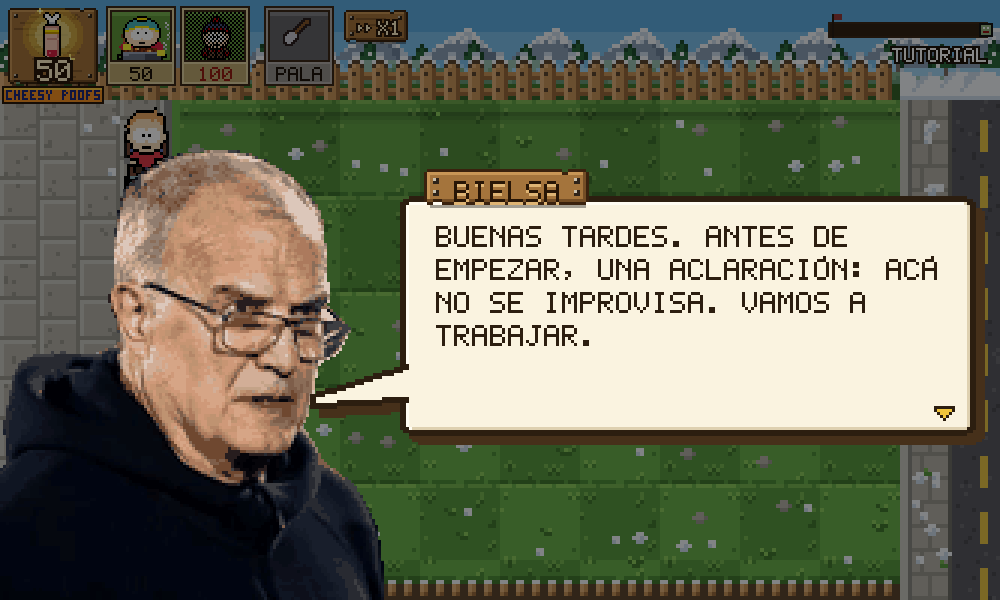

### 4.9 Fin de nivel

Al ganar o perder, Bielsa dice una frase con su retrato de victoria o de derrota. Después aparece la pantalla de resultado, con los zombies eliminados y el tiempo de juego, y estos botones:

| Botón | Cuándo aparece | Qué hace |
|---|---|---|
| **SIGUIENTE NIVEL** | Al ganar un nivel que no es el último | Va a elegir el equipo del nivel siguiente. |
| **REINTENTAR** | Siempre | Vuelve a jugar el mismo nivel. |
| **VOLVER AL MAPA** | Siempre | Vuelve al mapa de niveles. |
| **MENÚ PRINCIPAL** | Siempre | Vuelve al menú. |

Al ganar el nivel 3 el cartel dice **"¡GANASTE TODO!"**.

| Victoria | Derrota |
|---|---|
| 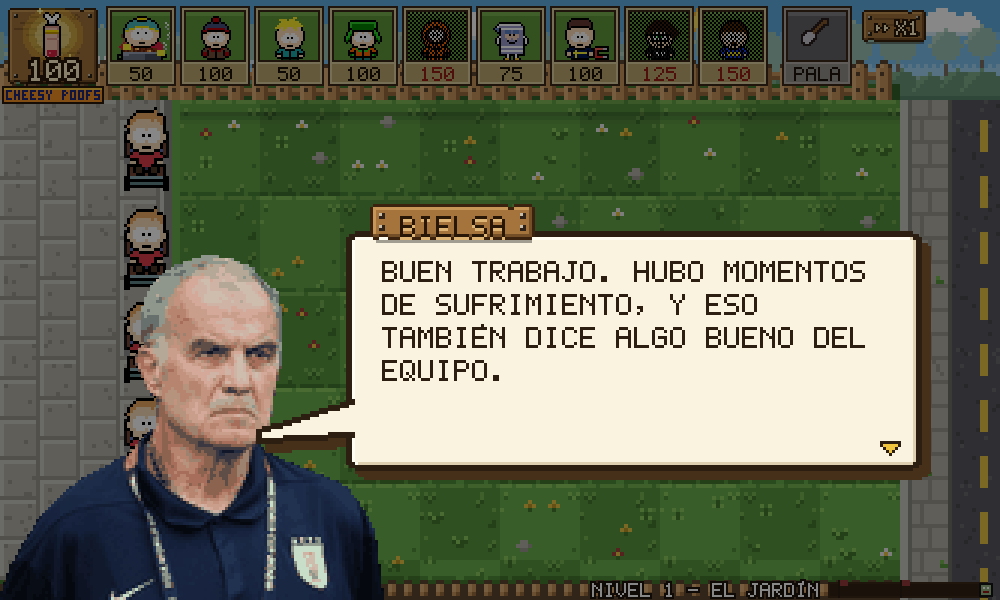 | 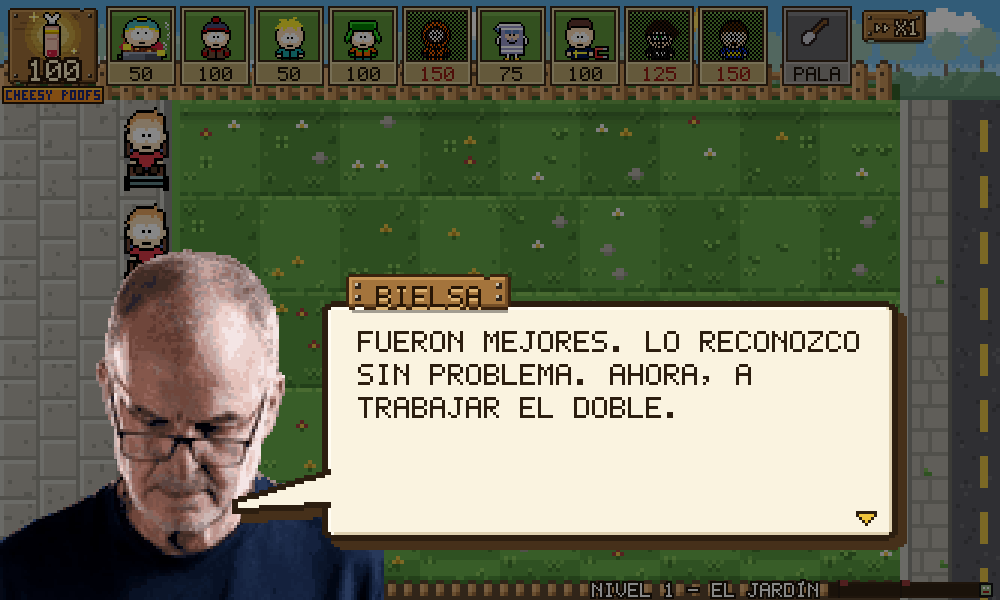 |
| 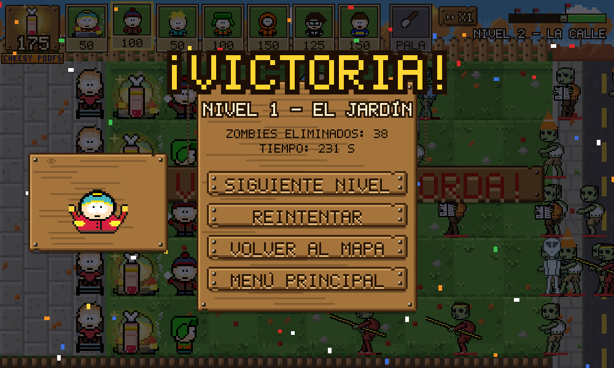 | 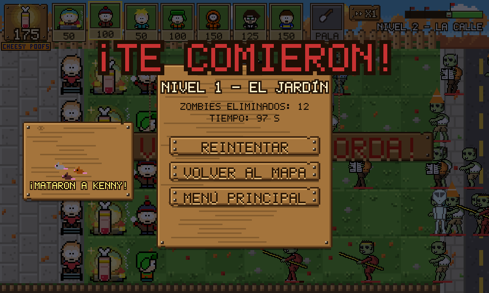 |

## 5. Cómo se juega

### 5.1 La energía (Cheesy Poofs)

Cada personaje cuesta energía. La energía aparece como **dedos brillantes** de dos maneras:

- **Del cielo**: cae un dedo cada 8 segundos (cada 5 en el tutorial).
- **De Chef Cartman**: el personaje generador suelta un dedo a los 6 segundos de plantado y, después, uno cada 18 segundos.

Cada dedo vale **25** y hay que hacerle clic para juntarlo. Un dedo que queda en el piso desaparece a los **9 segundos**. Cada nivel empieza con una cantidad fija de energía: 50 en el tutorial, 100 en los niveles 1 y 2, y 250 en el nivel 3.

En los diálogos, Bielsa llama "chili" a la energía, porque Cartman la obtiene cocinando chili.

### 5.2 Colocar personajes

1. Elegir la carta del personaje (clic o tecla `1` a `9`). Solo se puede elegir si alcanza la energía y la carta no está en recarga.
2. Hacer clic en una casilla libre del césped. Se descuenta el costo y la carta entra en **recarga**: se oscurece y hay que esperar su tiempo (ver la tabla de la sección 6) para volver a usarla.

No se puede colocar un personaje en una casilla ocupada.

### 5.3 La pala

La pala quita un personaje del césped y deja la casilla libre. **No devuelve la energía gastada.**

### 5.4 Las podadoras

Cada fila tiene una podadora (Timmy en su silla de ruedas). Cuando un zombie llega al borde izquierdo del césped, Timmy grita, cruza toda la fila y elimina a todos los zombies que encuentra. **Cada podadora se usa una sola vez por nivel.**

### 5.5 Oleadas y hordas

Los zombies llegan según un horario propio de cada nivel. La barra de progreso, abajo a la derecha, muestra cuánto falta. Las **banderas** de la barra marcan las **hordas**: grupos grandes de zombies que llegan más seguidos y se anuncian con un cartel unos segundos antes. La última horda es la **oleada final**.

### 5.6 Cómo se gana y cómo se pierde

- **Se gana** cuando ya llegaron todas las oleadas y no queda ningún zombie enemigo en el campo. Los zombies hipnotizados por Toallin no cuentan.
- **Se pierde** cuando un zombie cruza el borde izquierdo de una fila cuya podadora ya se usó y llega a la casa.

### 5.7 Velocidad

El botón de velocidad (o la tecla `F`) alterna entre **x1**, **x2** y **x3**. A mayor velocidad todo pasa más rápido (zombies, recargas, energía), pero las reglas no cambian. La velocidad elegida se mantiene al pasar de nivel.

## 6. Personajes (plantas)

Valores de `settings.py` (`PLANT_DATA`) y nombres de `data/catalogo.py`.

| Personaje | Costo | Recarga de la carta | Vida | Qué hace |
|---|---|---|---|---|
| **Chef Cartman** | 50 | 7,5 s | 300 | Generador. Cocina chili y suelta un dedo de energía (25) a los 6 s de plantado y después cada 18 s. Si el Alien aprieta su botón, deja de cocinar hasta que el Alien muere. |
| **Stan** | 100 | 7,5 s | 300 | Tira bolas de nieve a los zombies de su fila (20 de daño cada 1,4 s). El zombie golpeado se pone celeste y camina, come y se anima a la mitad de velocidad durante 4 s. Si la bola pega en una puerta, no lo frena. |
| **Butters** | 50 | 20 s | 4000 | Muro. No ataca, pero aguanta mucho: un zombie común tarda unos 40 s en comérselo. Llora mientras lo muerden. |
| **Kyle** | 100 | 7,5 s | 300 | Patea a Ike, que vuela en arco y cae sobre el zombie más cercano de su fila (20 de daño cada 1,4 s). Como cae desde arriba, le pega al cuerpo del zombie con puerta. |
| **Kenny** | 150 | 35 s | — | Explota casi enseguida de plantado y hace 1800 de daño a los zombies de un área de 3 × 3 casillas a su alrededor. No daña a los hipnotizados. A los 30 s reaparece una sola vez en la misma casilla (si sigue libre), espera a que un zombie entre en su área y vuelve a explotar. |
| **Toallin** | 75 | 30 s | 300 | El primer zombie que lo muerde se lo come y queda **hipnotizado**: se pone violeta, se da vuelta y ataca a los otros zombies. No funciona con el Sr. Garrison ni con el gigante. |
| **Santi** | 100 | 7,5 s | 300 | Imán. Le arranca el objeto de metal al zombie más cercano dentro de su alcance (unas 3 casillas a la redonda, en cualquier fila): el balde, la puerta o el pico del excavador. Después queda 15 s con el objeto pegado antes de poder volver a usarlo. El cono no es de metal. |
| **Jesús** | 125 | 35 s | — | Se enciende durante 1 s y explota en cruz: hace 350 de daño a todos los zombies de su fila y de su columna, y después desaparece. |
| **Gero** | 150 | 25 s | 300 | Si hay un zombie en la casilla de enfrente (y está libre), se agacha, salta y aplasta a **todos** los zombies de esa casilla, sin importar su vida. Se queda en la casilla nueva y descansa 18 s antes de volver a saltar. Si no tiene adónde saltar, aplasta su propia casilla. En el aire no lo pueden morder. |

## 7. Zombies

Valores de `settings.py` (`ZOMBIE_DATA`). La **vida total** suma cuerpo, armadura y escudo. La velocidad está en píxeles por segundo; el césped mide 720 px de ancho.

| Zombie | Vida total | Velocidad | Daño (por s) | Habilidad |
|---|---|---|---|---|
| **Terrance** (zombie normal) | 200 | 18 (normal) | 100 | Camina y se come lo que tenga adelante, siempre a saltitos. |
| **Philip** (zombie con cono) | 570 (200 + 370 del cono) | 18 | 100 | El cono absorbe el daño antes que el cuerpo; cuando se rompe, se le cae. |
| **Zombie con balde** | 1300 (200 + 1100 del balde) | 16 | 100 | Balde de metal: Santi se lo puede sacar. |
| **Zombie con puerta** | 1300 (200 + 1100 de escudo) | 18 | 100 | La puerta frena lo que viene de frente (bolas de nieve). Ike (desde arriba) y las explosiones la saltean. Santi se la saca. |
| **Zombie del diario** | 350 (200 + 150 del diario) | 18 | 100 | Si le rompen el diario, se enoja: se queda quieto 1 s y después corre a 48 y muerde 150 por segundo. |
| **El murciélago** | 340 | 38 (rápida) | 100 | Corre a saltitos y salta por encima de la primera planta que encuentra (aunque tenga una escalera): vuela de panza como en la lucha libre y cae al piso. Se levanta y después camina a 18. |
| **Trent Boyette** (zombie con escalera) | 340 | 30 | 100 | Al llegar a la primera planta le apoya una escalera (1 s) y la pasa por arriba. La escalera queda puesta y la usan los demás zombies. Después camina a 18. |
| **Sr. Garrison** | 1300 | 11 (lenta) | 400 | Tanque lento que muerde muy fuerte, en su rueda gigante. No usa escaleras y Toallin no lo hipnotiza. |
| **Randy** (zombie bungee) | 200 | 18 | 100 | Cae del cielo vestido de Spider-Man, colgado de una soga, en una casilla al azar, desde la tercera columna. Antes aparece una marca roja en el piso durante 2,5 s. Al aterrizar, camina y come; al recibir daño pierde el traje, luego la máscara. |
| **Cangrejo bailarín** | 340 | 18 | 100 | Es el cangrejo rojo de la gente cangrejo. Cada 15 s frena, baila 1,5 s e invoca hasta 4 cangrejos invocados (marrones) a su alrededor: adelante, atrás, arriba y abajo. |
| **Zombie excavador** | 300 | 26 | 100 | Avanza bajo tierra, donde no lo alcanzan los disparos. Sale en la primera columna, del lado de la casa, y come las plantas de atrás para adelante caminando hacia la derecha hasta irse de la pantalla. Si Santi le saca el pico, sale donde esté y sigue como un zombie normal. |
| **Gigante** | 3000 | 10 (lenta) | Aplasta | Aplasta cualquier planta de un golpe (1 s). Con la mitad de vida revolea al mini zombie hacia el fondo de la fila, cerca de la casa. No usa escaleras y no se puede hipnotizar. |
| **Mini zombie** | 150 | 24 (rápida) | 100 | Viaja en la espalda del gigante hasta que lo lanzan. |
| **Alien** | 300 | 22 (rápida) | 100 | Entra 2 casillas, aprieta su botón y deja a todos los Chef Cartman sin cocinar hasta que lo eliminan. Si una planta le corta el paso, se la come. |

## 8. Niveles y tutorial

### 8.1 Desbloqueo

Al abrir el juego solo está disponible el **Tutorial**. Ganar un nivel desbloquea el siguiente. **El progreso se guarda solo mientras el juego está abierto**: al cerrarlo, la próxima vez se empieza otra vez desde el tutorial.

### 8.2 Resumen de los niveles

| Nivel | Ambiente | Energía inicial | Personajes | Zombies que aparecen | Total de zombies | Hordas |
|---|---|---|---|---|---|---|
| **Tutorial** | Invierno | 50 | Solo Chef Cartman y Stan | Normal | 5 | 1 (oleada final) |
| **Nivel 1 — El jardín** | Día de sol | 100 | Equipo elegido (hasta 7) | Normal, cono, puerta, balde | 38 | 2 |
| **Nivel 2 — La calle** | Otoño | 100 | Equipo elegido | Normal, cono, diario, pértiga, alien, excavador, escalera, balde, puerta | 52 | 3 |
| **Nivel 3 — El centro** | Atardecer | 250 | Equipo elegido | Todos los anteriores más bailarín, bungee, Sr. Garrison y gigante (con el mini) | 56 | 3 |

En los niveles 1 a 3 se pueden elegir todos los personajes desde el principio.

### 8.3 El tutorial

El tutorial no tiene pantalla de equipo: se juega con Chef Cartman y Stan. Bielsa explica el juego en 12 frases y, en algunos pasos, espera a que el jugador haga algo antes de seguir. Mientras tanto, abajo aparece una pista sobre un tablón.

| Paso | Bielsa explica | Hay que |
|---|---|---|
| 1 a 3 | La presentación, la energía y cómo colocar un personaje | Plantar a Chef Cartman |
| 4 | Juntar la energía | Juntar un dedo brillante |
| 5 a 7 | El costo de las cartas, la recarga y cómo colocar a Stan | Plantar a Stan |
| 8 y 9 | La pala y las podadoras (acá empiezan los zombies) | Eliminar al primer zombie |
| 10 a 12 | La barra de progreso, cómo se gana y la despedida | Sobrevivir hasta el final |

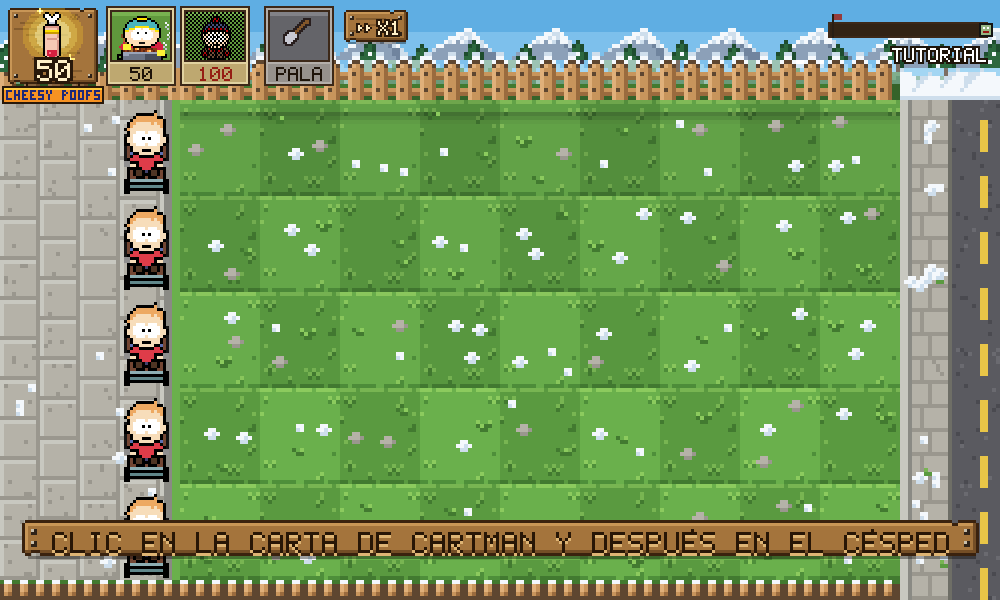

## 9. Preguntas frecuentes y problemas comunes

**Al ejecutar `python main.py` aparece "No module named pygame".**
Falta instalar la biblioteca gráfica: `pip install pygame-ce`. Si hay varias versiones de Python instaladas, probar con `python -m pip install pygame-ce`.

**El juego abre en una ventana chica o borrosa.**
En **OPCIONES** se puede elegir una resolución mayor o la pantalla completa. El juego siempre se dibuja a 1000 × 600 y se agranda sin suavizado para que el pixel art se vea nítido.

**Elegí una resolución y la ventana no entra en la pantalla.**
Solo se ofrecen resoluciones que entran en el monitor. Si aun así hay un problema, se puede borrar `config.json`: el juego vuelve a 1000 × 600 en ventana.

**No suena nada.**
El juego funciona sin sonido si la computadora no tiene una salida de audio disponible. Verificar el volumen del sistema y que la carpeta `assets/sonidos/` y `assets/musica/` estén completas.

**No puedo elegir una carta.**
Falta energía o la carta está en recarga (oscurecida). Hay que esperar o juntar más dedos.

**Cerré el juego y perdí los niveles ganados.**
Es así en esta versión: el progreso no se guarda en disco.

**Un zombie pasó por encima de mi planta sin comerla.**
Puede ser un zombie con pértiga (salta la primera planta) o una escalera apoyada sobre esa planta: todos los zombies la usan para pasar por arriba.

**Mis Chef Cartman dejaron de dar energía.**
Llegó un Alien y apretó su botón. Hay que eliminarlo para que vuelvan a cocinar.

**Un zombie del lado de la casa camina hacia la derecha.**
Es el excavador: sale en la primera columna y come las plantas de atrás para adelante. Stan y Kyle no le disparan porque lo tienen detrás; sirven Santi (le saca el pico), Kenny, Jesús, Gero o la pala.
