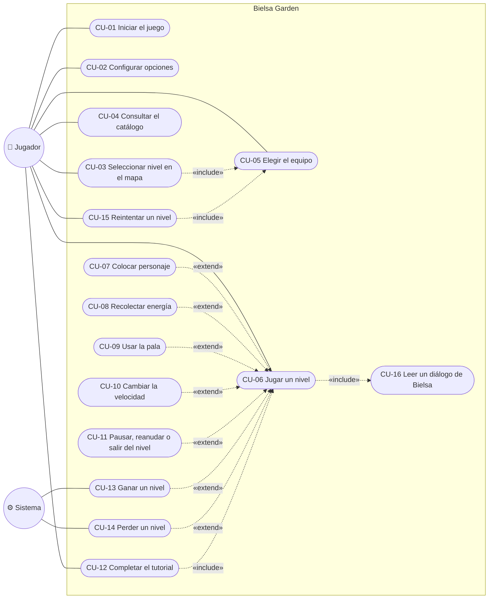

# Bielsa Garden — Casos de uso

| | |
|---|---|
| **Juego** | Bielsa Garden |
| **Materia** | _(a completar)_ |
| **Integrantes** | _(a completar)_ |
| **Fecha** | 5 de noviembre de 2026 |
| **Versión** | 1.0 |

---

## 1. Actores

| Actor | Tipo | Descripción |
|---|---|---|
| **Jugador** | Primario, humano | Persona que usa el juego con mouse y teclado: navega los menús, configura el juego, elige el equipo y juega los niveles. |
| **Sistema (juego)** | Secundario, interno | El propio juego, cuando ejecuta acciones sin intervención del jugador: hace avanzar las oleadas, mueve a los zombies, dispara, activa las podadoras y decide la victoria o la derrota. Se lo modela como actor para dejar explícito qué pasa por iniciativa del sistema. |

## 2. Diagrama de casos de uso

> Nota: Mermaid no tiene un diagrama de casos de uso nativo. Se usa un diagrama de flujo con la notación habitual: los actores son círculos, los casos de uso son óvalos y las relaciones «include» y «extend» son flechas punteadas.

## 3. Fichas de los casos de uso

### CU-01 — Iniciar el juego

| Campo | Contenido |
|---|---|
| **Actor** | Jugador |
| **Descripción** | El jugador abre el juego y llega al menú principal. |
| **Precondiciones** | Python y `pygame-ce` instalados; la carpeta del juego completa. |
| **Postcondiciones** | Se muestra el menú principal con los botones JUGAR, CATÁLOGO, OPCIONES y SALIR. |

**Flujo principal**
1. El jugador ejecuta `python main.py`.
2. El sistema lee `config.json` y abre la ventana con la resolución guardada.
3. El sistema muestra la pantalla de carga y prepara los gráficos y el audio.
4. El sistema reproduce la presentación animada con la música del menú.
5. Al terminar la presentación, el sistema muestra los botones del menú.

**Flujos alternativos**
- 4a. El jugador hace clic o aprieta `Enter`, `Espacio` o `Esc`: el sistema saltea la presentación y muestra los botones.
- 4b. El jugador vuelve al menú más tarde en la misma ejecución: el sistema no repite la presentación.
- 5a. El jugador elige SALIR: el sistema cierra el juego.

**Flujos de excepción**
- 2a. No existe `config.json`: el sistema usa 1000 × 600 en ventana.
- 3a. No hay salida de audio: el juego continúa sin sonido.

---

### CU-02 — Configurar opciones

| Campo | Contenido |
|---|---|
| **Actor** | Jugador |
| **Descripción** | El jugador cambia la resolución o la pantalla completa. |
| **Precondiciones** | El jugador está en el menú principal. |
| **Postcondiciones** | La configuración aplicada queda vigente y guardada en `config.json`. |

**Flujo principal**
1. El jugador elige OPCIONES.
2. El sistema muestra la pestaña *Pantalla* con la resolución y la casilla *Pantalla completa*. Solo ofrece las resoluciones que entran en el monitor.
3. El jugador cambia uno o ambos valores.
4. El jugador presiona APLICAR.
5. El sistema aplica la configuración y la guarda en `config.json`.

**Flujos alternativos**
- 4a. El jugador presiona VOLVER o `Esc` sin aplicar: el sistema descarta los cambios y vuelve al menú.

**Flujos de excepción**
- Ninguno identificado.

---

### CU-03 — Seleccionar nivel en el mapa

| Campo | Contenido |
|---|---|
| **Actor** | Jugador |
| **Descripción** | El jugador elige qué nivel jugar en el mapa de niveles. |
| **Precondiciones** | El jugador está en el menú principal. |
| **Postcondiciones** | Comienza el tutorial o se muestra la pantalla de equipo del nivel elegido. |

**Flujo principal**
1. El jugador elige JUGAR.
2. El sistema muestra el mapa con cada nivel en su estado: bloqueado, disponible o ganado.
3. El jugador pasa el mouse sobre un nivel y el sistema muestra su nombre.
4. El jugador hace clic en un nivel disponible o ganado.
5. El sistema hace un fundido a negro y abre la pantalla de equipo del nivel (CU-05).

**Flujos alternativos**
- 4a. El nivel elegido es el Tutorial: el sistema lo inicia directamente, sin pantalla de equipo (CU-12).
- 4b. El jugador presiona VOLVER o `Esc`: el sistema vuelve al menú.

**Flujos de excepción**
- 4c. El jugador hace clic en un nivel bloqueado: el sistema no hace nada.

---

### CU-04 — Consultar el catálogo

| Campo | Contenido |
|---|---|
| **Actor** | Jugador |
| **Descripción** | El jugador consulta la información de personajes y zombies. |
| **Precondiciones** | El jugador está en el menú principal. |
| **Postcondiciones** | Ninguna: el catálogo no modifica el estado del juego. |

**Flujo principal**
1. El jugador elige CATÁLOGO.
2. El sistema muestra la pestaña PERSONAJES con una ficha por cada personaje.
3. El jugador pasa el mouse sobre una ficha.
4. El sistema muestra el nombre, la descripción y los números del personaje (costo, daño, vida y recarga).
5. El jugador presiona VOLVER o `Esc` y el sistema vuelve al menú.

**Flujos alternativos**
- 3a. El jugador elige la pestaña ZOMBIES: el sistema muestra los zombies y, al pasar el mouse, su vida total, su daño por segundo y su velocidad.

**Flujos de excepción**
- Ninguno identificado.

---

### CU-05 — Elegir el equipo de personajes

| Campo | Contenido |
|---|---|
| **Actor** | Jugador |
| **Descripción** | Antes de un nivel, el jugador elige hasta 7 personajes. |
| **Precondiciones** | El jugador eligió un nivel distinto del tutorial (CU-03 o CU-15). |
| **Postcondiciones** | Comienza la partida con las cartas del equipo elegido, y el equipo queda recordado. |

**Flujo principal**
1. El sistema muestra los personajes disponibles, los lugares del equipo (precargados con el último equipo usado) y los zombies que vienen en el nivel.
2. El jugador hace clic en un personaje disponible y el sistema lo agrega al equipo.
3. El jugador repite el paso 2 hasta completar su equipo.
4. El jugador presiona ¡A JUGAR! (o `Enter`/`Espacio`).
5. El sistema guarda el equipo y comienza la partida (CU-06).

**Flujos alternativos**
- 2a. El jugador hace clic en un personaje del equipo: el sistema lo quita.
- 4a. El jugador presiona VOLVER o `Esc`: el sistema vuelve al mapa.

**Flujos de excepción**
- 2b. El equipo ya tiene 7 personajes: el sistema no agrega más.
- 4b. El equipo está vacío: el sistema muestra "ELEGÍ AL MENOS UN PERSONAJE" y no comienza la partida.

---

### CU-06 — Jugar un nivel

| Campo | Contenido |
|---|---|
| **Actores** | Jugador, Sistema |
| **Descripción** | El jugador defiende la casa de las oleadas de zombies. |
| **Precondiciones** | Se eligió el equipo (CU-05) o se inició el tutorial (CU-12). |
| **Postcondiciones** | El nivel termina en victoria (CU-13) o en derrota (CU-14), o el jugador sale desde la pausa (CU-11). |

**Flujo principal**
1. El sistema muestra el fondo del nivel, las cartas del equipo, la energía inicial y las podadoras.
2. Bielsa dice una frase al azar (CU-16).
3. El sistema comienza las oleadas: los zombies aparecen por la derecha según el horario del nivel y caen dedos de energía del cielo.
4. El jugador recolecta energía (CU-08) y coloca personajes (CU-07).
5. Los personajes atacan automáticamente a los zombies; los zombies avanzan y comen lo que tienen adelante.
6. El sistema avisa la llegada de cada horda con un cartel.
7. Los pasos 3 a 6 se repiten hasta que el nivel termina.

**Flujos alternativos**
- 4a. El jugador usa la pala (CU-09), cambia la velocidad (CU-10) o pausa (CU-11).
- 5a. Un zombie llega al borde izquierdo de una fila con la podadora disponible: el sistema activa la podadora, que elimina a todos los zombies de esa fila y queda gastada.

**Flujos de excepción**
- 5b. Un zombie llega al borde de una fila con la podadora gastada: se pierde el nivel (CU-14).

---

### CU-07 — Colocar personaje

| Campo | Contenido |
|---|---|
| **Actor** | Jugador |
| **Descripción** | El jugador coloca un personaje del equipo en una casilla del césped. |
| **Precondiciones** | Partida en curso, sin pausa ni diálogo. |
| **Postcondiciones** | El personaje queda en la casilla, se descuenta su costo y su carta entra en recarga. |

**Flujo principal**
1. El jugador hace clic en una carta (o aprieta `1` a `9`).
2. El sistema verifica que alcance la energía y que la carta no esté en recarga, y la marca como seleccionada.
3. El jugador hace clic en una casilla libre del césped.
4. El sistema crea el personaje en esa casilla, descuenta el costo e inicia la recarga de la carta.

**Flujos alternativos**
- 1a. El jugador vuelve a elegir la misma carta o hace clic derecho: el sistema cancela la selección.

**Flujos de excepción**
- 2a. No alcanza la energía o la carta está en recarga: el sistema no la selecciona.
- 3a. La casilla está ocupada: el sistema no coloca nada y la carta sigue seleccionada.
- 3b. Mientras la carta estaba seleccionada, dejó de estar disponible: el sistema cancela la selección.

---

### CU-08 — Recolectar energía

| Campo | Contenido |
|---|---|
| **Actor** | Jugador |
| **Descripción** | El jugador junta un dedo de energía. |
| **Precondiciones** | Hay al menos un dedo en pantalla (caído del cielo o soltado por Chef Cartman). |
| **Postcondiciones** | La energía aumenta en 25 y el dedo desaparece. |

**Flujo principal**
1. El jugador hace clic sobre un dedo.
2. El sistema suma 25 al contador y quita el dedo.

**Flujos alternativos**
- 1a. Hay una carta seleccionada: el clic sobre el dedo tiene prioridad y no coloca el personaje.

**Flujos de excepción**
- 1b. El jugador no junta el dedo en 9 segundos: el dedo desaparece sin sumar energía.

---

### CU-09 — Usar la pala

| Campo | Contenido |
|---|---|
| **Actor** | Jugador |
| **Descripción** | El jugador quita un personaje del césped. |
| **Precondiciones** | Partida en curso; hay al menos un personaje colocado. |
| **Postcondiciones** | La casilla queda libre. La energía gastada no se devuelve. |

**Flujo principal**
1. El jugador hace clic en PALA (o aprieta `S`).
2. El jugador hace clic sobre un personaje.
3. El sistema quita el personaje y deselecciona la pala.

**Flujos alternativos**
- 2a. El jugador hace clic en una casilla vacía: el sistema no quita nada y deselecciona la pala.
- 1a. El jugador vuelve a elegir la pala o hace clic derecho: el sistema la deselecciona.

**Flujos de excepción**
- Ninguno identificado.

---

### CU-10 — Cambiar la velocidad

| Campo | Contenido |
|---|---|
| **Actor** | Jugador |
| **Descripción** | El jugador acelera o normaliza el ritmo de la partida. |
| **Precondiciones** | Partida en curso. |
| **Postcondiciones** | La partida avanza a la velocidad elegida, que también se usa en los niveles siguientes. |

**Flujo principal**
1. El jugador hace clic en el botón de velocidad (o aprieta `F`).
2. El sistema pasa a la velocidad siguiente (x1 → x2 → x3 → x1) y actualiza el botón.

**Flujos alternativos**
- Ninguno.

**Flujos de excepción**
- 1a. Hay un diálogo en pantalla: la tecla avanza el diálogo en lugar de cambiar la velocidad.

---

### CU-11 — Pausar, reanudar o salir del nivel

| Campo | Contenido |
|---|---|
| **Actor** | Jugador |
| **Descripción** | El jugador detiene la partida y decide si continuar o salir. |
| **Precondiciones** | Partida en curso, sin diálogo. |
| **Postcondiciones** | La partida continúa, o se vuelve al mapa o al menú perdiendo el avance del nivel. |

**Flujo principal**
1. El jugador aprieta `P` o `Esc`.
2. El sistema congela la partida y muestra el menú de pausa.
3. El jugador elige CONTINUAR (o vuelve a apretar `P`/`Esc`).
4. El sistema reanuda la partida desde el mismo punto.

**Flujos alternativos**
- 3a. El jugador elige VOLVER AL MAPA: el sistema abre el mapa de niveles.
- 3b. El jugador elige MENÚ PRINCIPAL: el sistema abre el menú.

**Flujos de excepción**
- 2a. Durante la pausa, las teclas de las cartas y de la pala no tienen efecto.

---

### CU-12 — Completar el tutorial

| Campo | Contenido |
|---|---|
| **Actor** | Jugador |
| **Descripción** | El jugador aprende a jugar siguiendo las indicaciones de Bielsa. |
| **Precondiciones** | El jugador eligió el Tutorial en el mapa. |
| **Postcondiciones** | Si gana, el tutorial queda ganado y se desbloquea el Nivel 1. |

**Flujo principal**
1. El sistema inicia la partida con Chef Cartman y Stan, sin oleadas.
2. Bielsa presenta el juego y pide colocar a Chef Cartman.
3. El jugador coloca a Chef Cartman (CU-07) y el sistema avanza al paso siguiente.
4. Bielsa pide juntar energía; el jugador junta un dedo (CU-08).
5. Bielsa explica el costo, la recarga y pide colocar a Stan; el jugador lo coloca.
6. Bielsa explica la pala y las podadoras, y el sistema inicia las oleadas.
7. El jugador elimina al primer zombie.
8. Bielsa explica la barra de progreso y cómo se gana, y se despide.
9. El jugador sobrevive a la oleada final y gana (CU-13).

**Flujos alternativos**
- 2a–8a. En cada paso que espera una acción, el sistema muestra una pista abajo y, si corresponde, una flecha sobre la carta que hay que usar.

**Flujos de excepción**
- 9a. Un zombie llega a la casa: se pierde (CU-14) y se puede reintentar (CU-15).

---

### CU-13 — Ganar un nivel

| Campo | Contenido |
|---|---|
| **Actor** | Sistema (iniciador), Jugador |
| **Descripción** | El sistema detecta la victoria y la informa. |
| **Precondiciones** | Ya llegaron todas las oleadas y no queda ningún zombie enemigo (los hipnotizados no cuentan). |
| **Postcondiciones** | El nivel queda ganado, se desbloquea el siguiente y se muestra la pantalla de resultado. |

**Flujo principal**
1. El sistema muestra el cartel "¡Nivel completado!".
2. El sistema registra el nivel como ganado.
3. Bielsa dice una frase de victoria al azar, con su retrato de victoria (CU-16).
4. El jugador avanza el diálogo.
5. El sistema muestra "¡VICTORIA!", los zombies eliminados, el tiempo y los botones.
6. El jugador elige SIGUIENTE NIVEL, REINTENTAR (CU-15), VOLVER AL MAPA o MENÚ PRINCIPAL.

**Flujos alternativos**
- 5a. Es el último nivel: el cartel dice "¡GANASTE TODO!" y no aparece SIGUIENTE NIVEL.
- 6a. El jugador aprieta `Esc`: el sistema vuelve al mapa.

**Flujos de excepción**
- Ninguno identificado.

---

### CU-14 — Perder un nivel

| Campo | Contenido |
|---|---|
| **Actor** | Sistema (iniciador), Jugador |
| **Descripción** | El sistema detecta la derrota y la informa. |
| **Precondiciones** | Un zombie enemigo llegó a la casa por una fila sin podadora. |
| **Postcondiciones** | Se muestra la pantalla de resultado de derrota. El progreso no cambia. |

**Flujo principal**
1. El sistema detiene la partida.
2. Bielsa dice una frase de derrota al azar, con su retrato de derrota (CU-16).
3. El jugador avanza el diálogo.
4. El sistema muestra "¡TE COMIERON!" y los botones REINTENTAR, VOLVER AL MAPA y MENÚ PRINCIPAL.
5. El jugador elige una opción.

**Flujos alternativos**
- 5a. El jugador aprieta `Esc`: el sistema vuelve al mapa.

**Flujos de excepción**
- Ninguno identificado.

---

### CU-15 — Reintentar un nivel

| Campo | Contenido |
|---|---|
| **Actor** | Jugador |
| **Descripción** | El jugador vuelve a jugar el nivel que acaba de terminar. |
| **Precondiciones** | Se está en la pantalla de resultado. |
| **Postcondiciones** | El nivel empieza de cero. |

**Flujo principal**
1. El jugador elige REINTENTAR.
2. El sistema abre la pantalla de equipo del mismo nivel, con el último equipo precargado (CU-05).
3. El jugador confirma y comienza la partida (CU-06).

**Flujos alternativos**
- 2a. El nivel es el tutorial: el sistema lo inicia directamente.

**Flujos de excepción**
- Ninguno identificado.

---

### CU-16 — Leer un diálogo de Bielsa

| Campo | Contenido |
|---|---|
| **Actor** | Jugador |
| **Descripción** | Bielsa habla en una burbuja y el jugador avanza el texto. |
| **Precondiciones** | Comienza un nivel, avanza un paso del tutorial o termina un nivel. |
| **Postcondiciones** | El diálogo se cierra y la partida continúa (o aparece la pantalla de resultado). |

**Flujo principal**
1. El sistema oscurece la partida, hace entrar el retrato de Bielsa y muestra la burbuja.
2. El texto aparece letra por letra, con un sonido.
3. Al completarse, el sistema muestra una flechita que rebota.
4. El jugador hace clic o aprieta una tecla, y el sistema pasa a la frase siguiente o cierra el diálogo.

**Flujos alternativos**
- 2a. El jugador hace clic mientras el texto se escribe: el sistema lo completa de golpe.
- 4a. El jugador aprieta `Esc`: el sistema cierra todo el diálogo.

**Flujos de excepción**
- Ninguno identificado.
