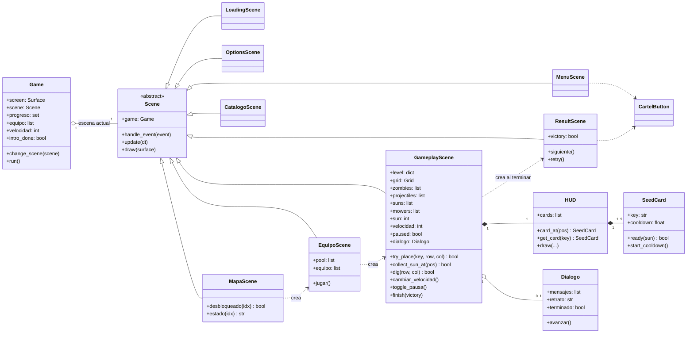
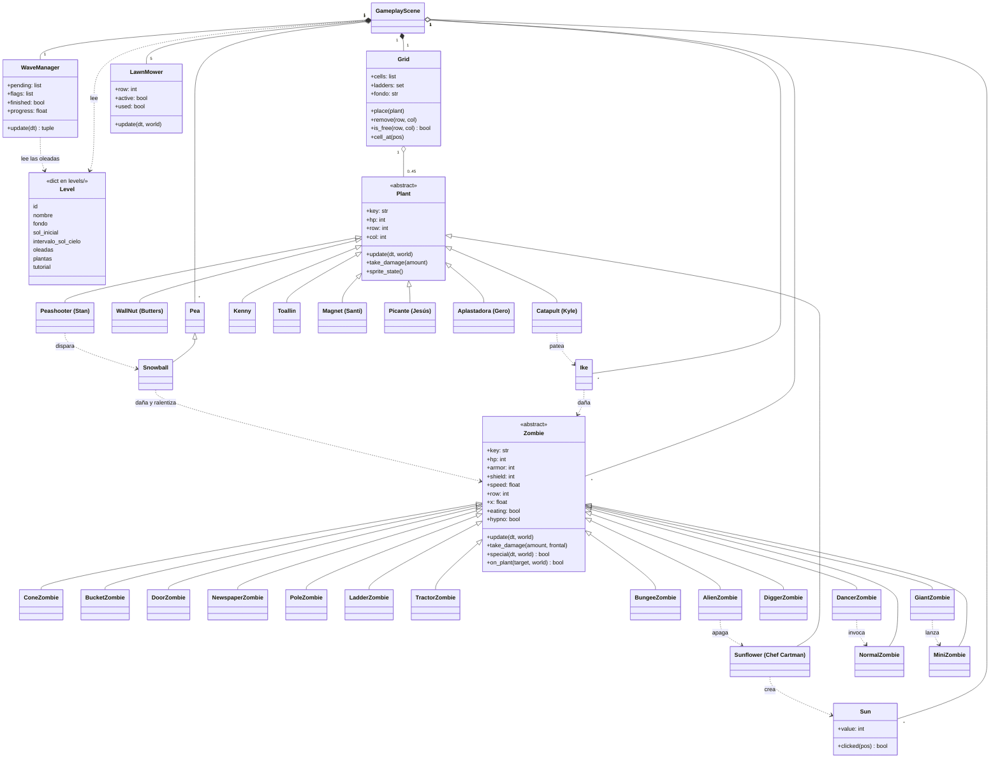
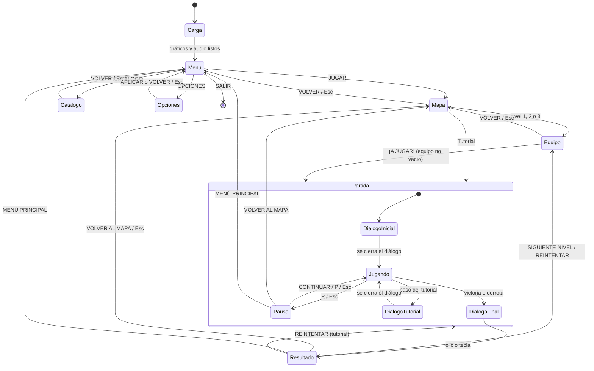
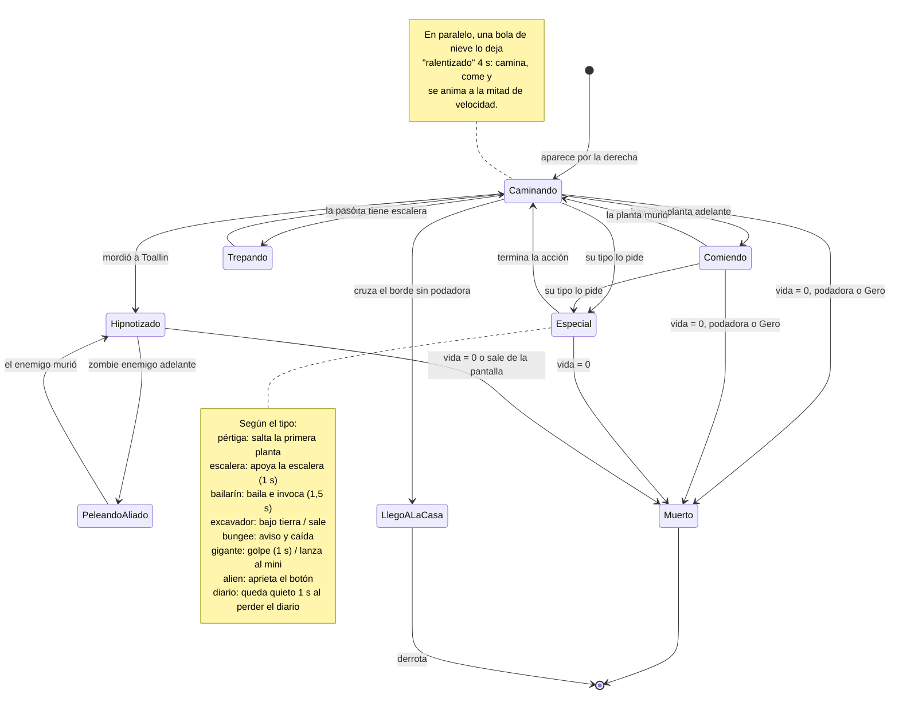
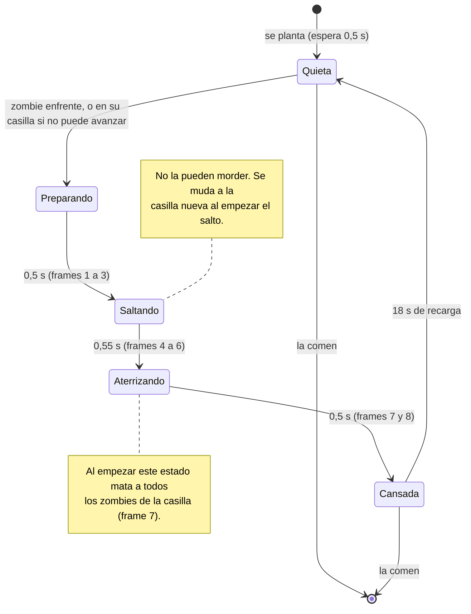
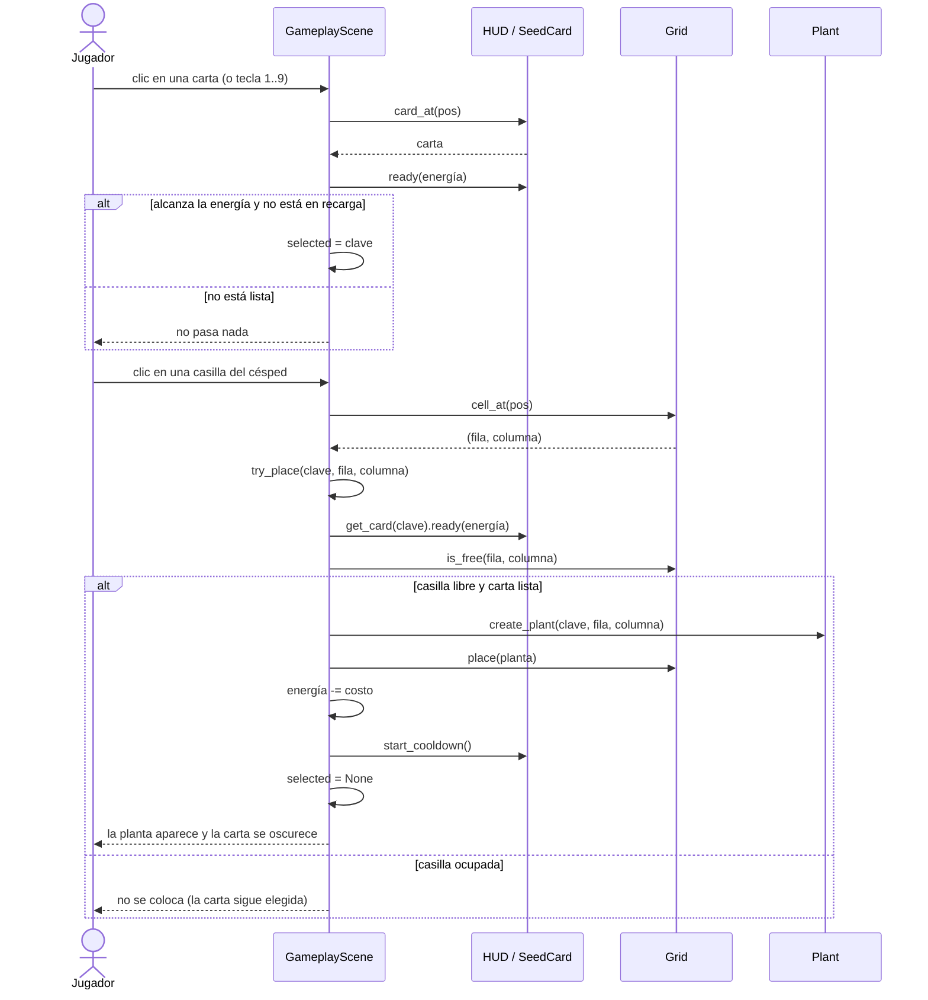
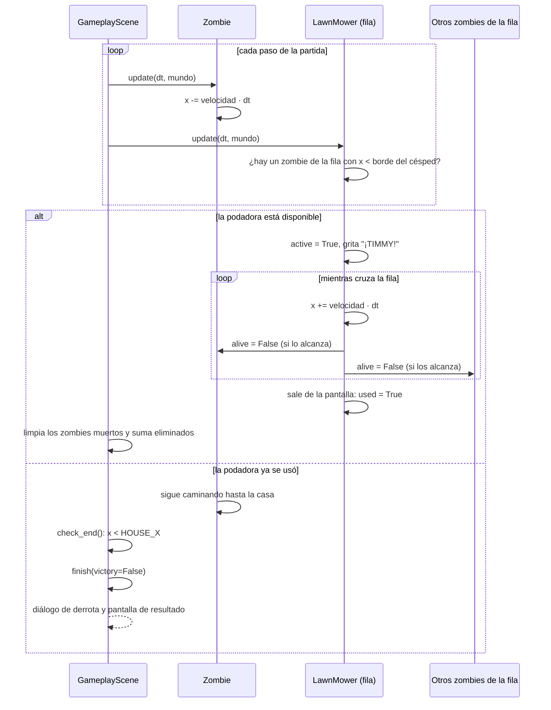
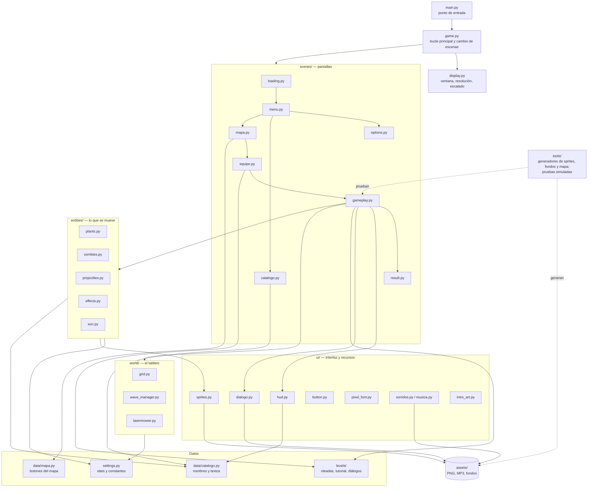

# Bielsa Garden — Diagramas

| | |
|---|---|
| **Juego** | Bielsa Garden |
| **Materia** | _(a completar)_ |
| **Integrantes** | _(a completar)_ |
| **Fecha** | 5 de noviembre de 2026 |
| **Versión** | 1.0 |

---

Todos los diagramas están en Mermaid y reflejan las clases y los nombres del código. Las claves internas (por ejemplo, `girasol` o `aplastadora`) se conservan de versiones anteriores; la equivalencia con los nombres que ve el jugador está en el [Manual técnico](05_manual_tecnico.md#4-dónde-está-cada-cosa).

## 1. Diagrama de clases

### 1.1 Escenas, juego e interfaz

### 1.2 Mundo, niveles, plantas, zombies y proyectiles

## 2. Diagrama de estados de las escenas

> Entre una escena y otra, `Game.change_scene` muestra una transición de "cortina de cartulina". Al entrar a un nivel desde el mapa hay además un fundido a negro.

## 3. Diagramas de estados de las entidades

### 3.1 Zombie (comportamiento general)

### 3.2 Gero (Aplastadora)

## 4. Diagramas de secuencia

### 4.1 Colocar una planta

### 4.2 Un zombie llega a la podadora

## 5. Diagrama de arquitectura

